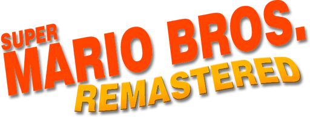

<div align="center"><h1 align="center">Super Mario Bros. Remastered · Nintendo Switch port</h1>
</div>

A wrapper/loader that runs **Super Mario Bros. Remastered** (an open-source fan
game created by [JoeMama](https://github.com/JHDev2006/Super-Mario-Bros.-Remastered-Public),
GPL-3.0) on the Nintendo Switch, built **straight from the upstream repository**.

It loads the official Godot arm64-v8a Android engine (`libgodot_android.so`),
provides a minimal Android-like environment (fake JNI, a bionic→newlib libc
shim, and a GLES3/EGL import table backed by mesa), drives the engine's
`GodotLib` native lifecycle directly, and mounts the game as a `game.pck`
exported from upstream. Same technique and wrapper architecture as the
[smwr_nx](https://github.com/delsonazevedo/Super-Mario-World-Remastered-Plus-Switch) port.

Because the game data comes from upstream (not from a separate Android fork),
updating the port to a new upstream version is a single command.

### How to install

1. Download `smbr_nx.zip` from the [Releases](../../releases) page.
2. Extract it to the root of your SD card (it creates `/switch/smbr_nx/`).
3. Copy your own Super Mario Bros. (NES) ROM to `/switch/smbr_nx/save/baserom.nes`.
4. Launch it from hbmenu through a **title override** (hold R while opening a game).

The first launch extracts the game's graphics from your ROM and compiles the
shaders, so it takes a while; later launches are much faster.

On your SD card, the app lives in `/switch/smbr_nx/`:

```
/switch/smbr_nx/smbr.nro              <- the port (this repo builds it)
/switch/smbr_nx/libgodot_android.so   <- Godot 4.6.3 arm64-v8a engine   } built by
/switch/smbr_nx/libc++_shared.so      <- matching C++ runtime           } tools/build_payload.sh
/switch/smbr_nx/game.pck              <- game data exported from upstream }
/switch/smbr_nx/save/baserom.nes      <- your legally owned Super Mario Bros. (NES) dump
```

**Place your ROM before first launch**, at exactly `/switch/smbr_nx/save/baserom.nes`.

Launch it through a **game/title override** (hold R on a game and open it) or a
forwarder, so the port runs with full RAM. It will not work in applet/album mode.

Saves and `config.txt` live in `/switch/smbr_nx/save/`.

### How to build

Every push to GitHub builds everything through GitHub Actions
(`.github/workflows/build.yml`): `smbr.nro`, the game payload, and the
ready-to-copy `smbr_nx.zip`, available as workflow artifacts. Pushing a tag
such as `v1.1.0` also publishes that zip as a release.

To build locally instead:

#### 1. The game payload (`game.pck` + engine `.so` files)

On Linux x86_64 (or WSL) with `git`, `curl`, `unzip`, `python3`:

```sh
tools/build_payload.sh                 # latest upstream stable release (e.g. 1.1-stable)
tools/build_payload.sh main            # or any upstream tag / branch / commit
```

The script downloads the Godot 4.6.3 headless editor and only the Android
template out of the export templates, clones upstream, applies
`tools/smb1r-switch.patch`, exports `game.pck`, and boots it headless as a
smoke test. Output goes to `payload/smbr_nx/`; `payload_version.txt` records
the upstream commit and Godot version used.

The Switch patch is deliberately tiny:

* the two optional GDExtensions (Discord RPC and the GIF loader) are left out
  of the Switch build, and the scripts that use them check that their
  singletons exist first;
* an Android export preset (for the `.pck` only) and ETC2/ASTC texture import
  are added by the script, not by the patch, so upstream changes to
  `project.godot` / `export_presets.cfg` never conflict.

The engine version used by the payload must match the one the wrapper was
built for (`GODOT_VERSION` in the script, 4.6.3 by default).

#### 2. The wrapper (`smbr.nro`)

You need devkitA64 (devkitPro) with these packages:

* `switch-mesa`
* `switch-libdrm_nouveau`
* `switch-zlib`

```sh
make
```

### Credits
- **JoeMama** and contributors — [Super Mario Bros. Remastered (the game, GPL-3.0)](https://github.com/JHDev2006/Super-Mario-Bros.-Remastered-Public)
- **delsonazevedo** — [the original Switch wrapper](https://github.com/delsonazevedo/Super-Mario-Bros.-Remastered-Switch) this port builds on
- **mircowuffwuff** — [the Android port](https://github.com/mircowuffwuff/super-mario-bros.-remastered-android) the original wrapper ran
- **fgsfds** and **NaGaa95** — the Switch so-loader groundwork

### Legal

This project has no affiliation with Nintendo, and **no Nintendo ROM or
Nintendo assets are included or distributed**: the game extracts its graphics
from the ROM you supply, which must be your own legal dump.

Release zips contain `game.pck`, built from the GPL-3.0 sources of
[Super Mario Bros. Remastered](https://github.com/JHDev2006/Super-Mario-Bros.-Remastered-Public)
(see its LICENSE) plus the changes in `tools/smb1r-switch.patch`; you can rebuild
it from source with `tools/build_payload.sh`. They also contain the unmodified
Godot Engine Android binaries (`libgodot_android.so`, `libc++_shared.so`), MIT
licensed (Godot) and Apache-2.0 with LLVM exception (libc++). This wrapper's own
source is MIT, see LICENSE.

### Donations

This port is completely free and open-source. Optional donations to support the development are always welcome:

[](https://ko-fi.com/toniisound)
[](https://paypal.me/toniisound)
